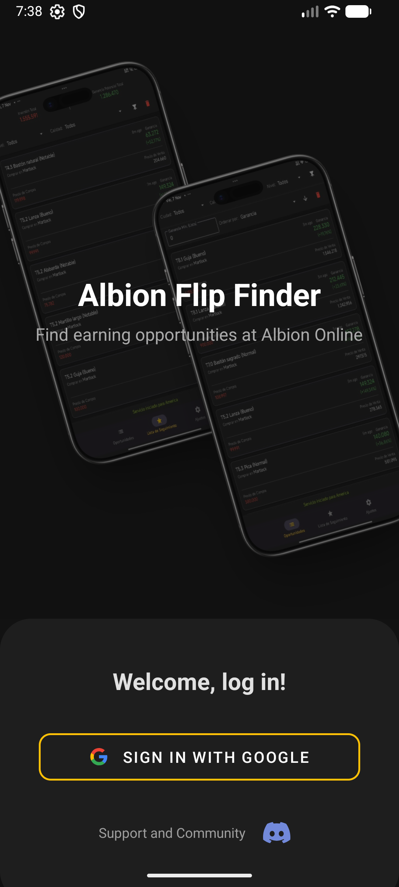
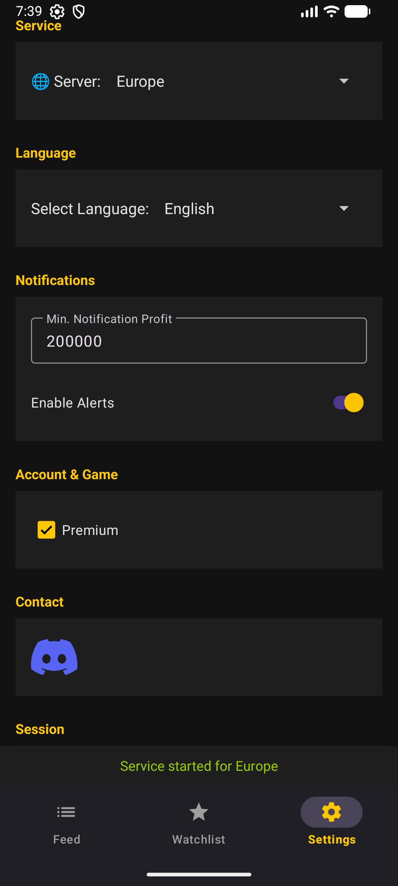
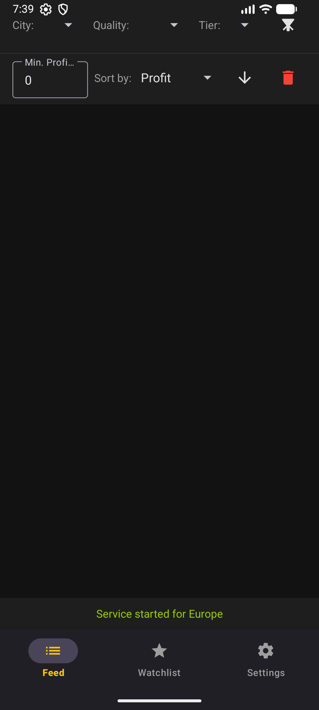
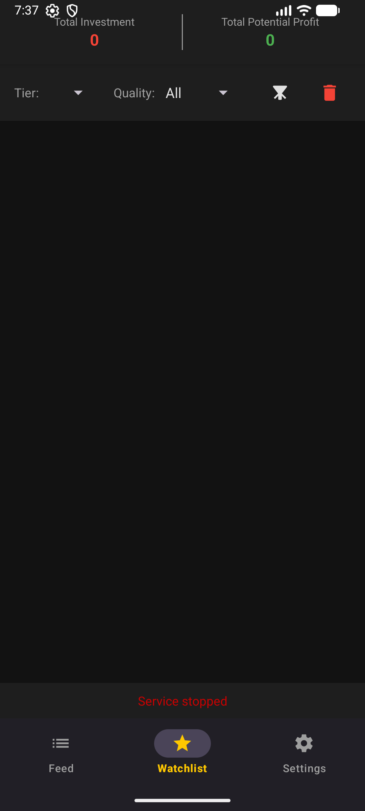
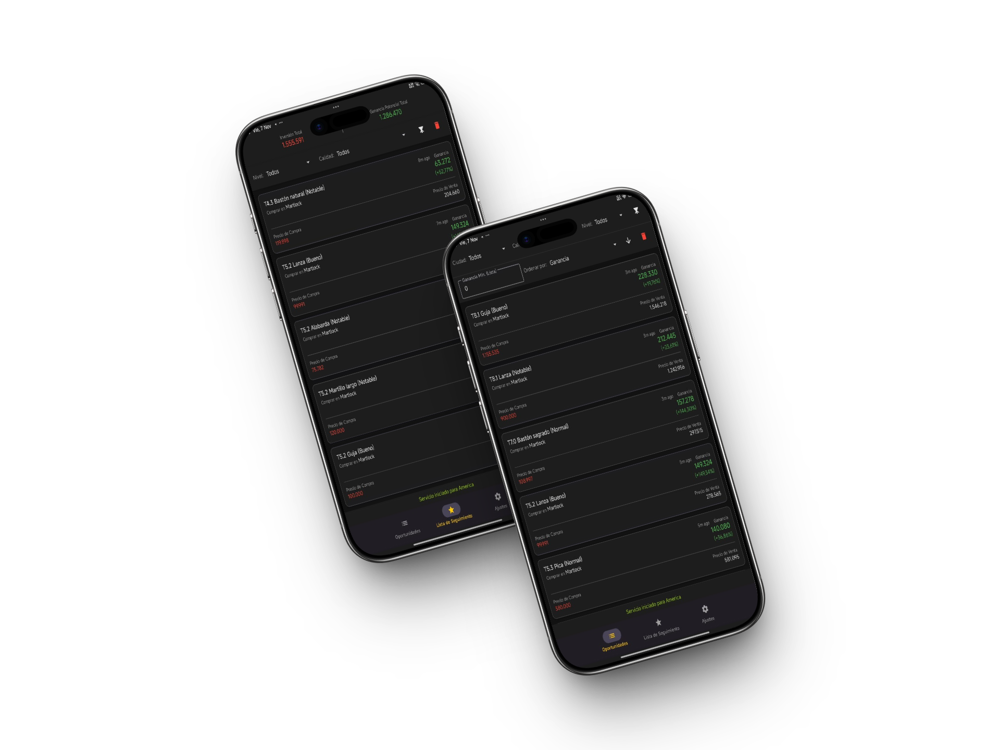
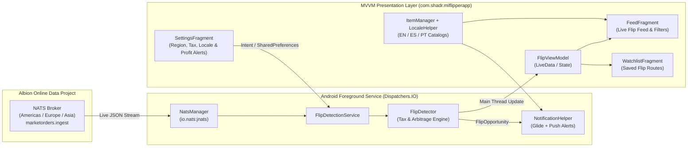

# Albion Flip Finder — Real-Time Market Arbitrage & Flip Detector for Android


**Albion Flip Finder** is a native Android application written in **Kotlin** that detects profitable cross-city market arbitrage opportunities ("flips") in *Albion Online* in real time. It connects directly to the **Albion Online Data Project (AODP)** NATS message broker (`io.nats:jnats`) to ingest and analyze live buy/sell orders across all Royal Cities, Caerleon, Brecilien, and the Black Market.

> **Publication Note:** This application was independently developed and previously published on the Google Play Store under package ID `com.shadr.miflipperapp` (historical commercial release; the developer's Google Play Console account is no longer active).

---

## 📱 App Screenshots & Visual Assets

### 1. Authentic Runtime Screenshots (Android Emulator Execution)
> Captured directly from `app-debug.apk` running on an Android Emulator (`1080x2400`).

| Login Screen (`LoginActivity`) | Settings & Active NATS Service (`SettingsFragment`) | Live Flip Feed (`FeedFragment`) | Saved Watchlist (`WatchlistFragment`) |
| :---: | :---: | :---: | :---: |
|  |  |  |  |

### 2. Promotional Mockups & Brand Artwork (Historical Google Play Release)
> Promotional marketing assets created for the original Google Play Store listing.

| Promotional UI Mockup | App Icon | Promotional Feature Artwork |
| :---: | :---: | :---: |
|  |  |  |

---

## ⚡ Key Implemented Features

- **Real-Time NATS Order Streaming (`NatsManager.kt`):**
  - Connects asynchronously via `io.nats:jnats` to the public Albion Online Data Project NATS servers across all 3 global regions (**Americas**, **Europe**, and **Asia**).
  - Subscribes to `marketorders.ingest` and deserializes live `MarketOrder` payloads on background `Dispatchers.IO` coroutines.
- **Cross-City Arbitrage & Tax Engine (`FlipDetector.kt`):**
  - Tracks competing buy and sell orders per item (`ItemId`, tier, enchantment, quality level) across 7 markets (`Bridgewatch`, `Fort Sterling`, `Lymhurst`, `Martlock`, `Thetford`, `Caerleon`, `Brecilien`) and the `Black Market`.
  - Calculates exact **net profit** and **ROI percentage** (`FlipOpportunity.kt`) after deducting Albion Online's market taxes (**6.5% With Premium** vs. **10.5% Without Premium**, including the 2.5% setup fee) and enforces a 30-minute staleness window (`MAX_DATA_AGE_MS`) to filter out expired orders.
- **Persistent Foreground Detection Service (`FlipDetectionService.kt`):**
  - Runs a resilient Android `Service` (`foregroundServiceType="dataSync"`) so market monitoring continues while the user plays or switches apps.
  - Dispatches high-priority push notifications (`NotificationHelper.kt`) with item icons rendered via **Glide**, filtered by the user's custom minimum profit threshold.
- **Live Feed, Watchlist & Multi-Language Support (`FeedFragment.kt`, `WatchlistFragment.kt`, `LocaleHelper.kt`):**
  - Interactive live flip feed (`FlipAdapter.kt`, `FlipViewModel.kt`) with multi-criteria filtering (origin city, destination city, tier, enchantment, quality, minimum profit).
  - Persistent Watchlist (`WatchlistFragment.kt`) to bookmark specific profitable routes.
  - Full localization and offline item catalogs in **English (`assets/items.txt`)**, **Spanish (`assets/es/items.txt`)**, and **Portuguese (`assets/pt/items.txt`)** managed by `ItemManager.kt` and `LocaleHelper.kt`.
- **Authentication, Licensing & Monetization (`LoginActivity.kt`, `LicenseManager.kt`, `MainActivity.kt`):**
  - Integrates **Firebase Authentication** with **Android Credential Manager (Google Sign-In)**, session verification (`LicenseManager.kt`), and **Google AdMob** integration.

---

## 🏗️ System Architecture



---

## 🛠️ Tech Stack & Libraries

| Category | Technology |
| :--- | :--- |
| **Language & Platform** | Kotlin 2.0.21, Android SDK 24–35 (Java 11 bytecode target) |
| **Architecture** | MVVM (`ViewModel`, `LiveData`, `ViewBinding`), Android Foreground `Service` |
| **Concurrency** | Kotlin Coroutines (`kotlinx-coroutines-android`, `Dispatchers.IO`) |
| **Real-Time Messaging** | NATS Java Client (`io.nats:jnats:2.16.14`) |
| **Networking & Serialization** | Retrofit 2 (`2.9.0`), Gson (`2.10.1`) |
| **UI & Image Loading** | Material Design 3, `RecyclerView`, Navigation Component (`navigation-fragment-ktx`), `Glide` (`4.16.0`), `Lottie` (`6.4.0`), `MPAndroidChart` (`v3.1.0`) |
| **Auth & Cloud Services** | Firebase Auth (`firebase-bom:34.4.0`), Google Identity Credential Manager (`credentials:1.5.0`), Google Play Services Ads (`23.1.0`) |

---

## 📂 Project Structure

```text
MiFlipperApp/
├── app/
│   ├── src/main/
│   │   ├── assets/
│   │   │   ├── items.txt                      # Offline Albion item catalog (English)
│   │   │   ├── es/items.txt                   # Offline Albion item catalog (Spanish)
│   │   │   └── pt/items.txt                   # Offline Albion item catalog (Portuguese)
│   │   ├── java/com/shadr/miflipperapp/
│   │   │   ├── Constants.kt                   # Shared preferences & app constants
│   │   │   ├── FeedFragment.kt                # Live flip stream & multi-filter UI
│   │   │   ├── FlipAdapter.kt                 # RecyclerView adapter for FlipOpportunity cards
│   │   │   ├── FlipDetectionService.kt        # Foreground NATS listener & notification dispatcher
│   │   │   ├── FlipDetector.kt                # Core cross-city arbitrage & tax calculation engine
│   │   │   ├── FlipOpportunity.kt             # Data model for profitable buy/sell routes
│   │   │   ├── FlipViewModel.kt               # Shared MVVM state holder for live & saved flips
│   │   │   ├── ItemManager.kt                 # Localized item name & Render API icon resolver
│   │   │   ├── LicenseManager.kt              # User license & trial state manager
│   │   │   ├── LocaleHelper.kt                # Runtime language switcher (EN / ES / PT)
│   │   │   ├── LoginActivity.kt               # Firebase + Google Credential Manager sign-in
│   │   │   ├── MainActivity.kt                # Bottom navigation host & service lifecycle
│   │   │   ├── MarketOrder.kt                 # AODP NATS order payload model
│   │   │   ├── MiFlipperApplication.kt        # Application singleton & ViewModel owner
│   │   │   ├── NatsManager.kt                 # Multi-region NATS broker connection manager
│   │   │   ├── NotificationHelper.kt          # Notification channels & Glide icon alerts
│   │   │   ├── SettingsFragment.kt            # Server region, Premium tax & alert configuration
│   │   │   └── WatchlistFragment.kt           # Bookmarked flips watchlist UI
│   │   └── res/                               # XML layouts, drawables, navigation & EN/ES/PT strings
│   └── google-services.json.example           # Sanitized Firebase configuration template
├── docs/screenshots/                          # Authentic app mockups and artwork
└── build.gradle.kts                           # Gradle Kotlin DSL configuration
```

---

## 🚀 Setup & Build Instructions

### Prerequisites
- **Android Studio Ladybug (2024.2+)** or command-line Android SDK (`compileSdk 35`)
- **JDK 17 or JDK 21**

### 1. Clone the repository
```bash
git clone https://github.com/Yhoanes/albion-flip-finder.git
cd albion-flip-finder
```

### 2. Configure Firebase template
Copy the sanitized Firebase configuration template to `app/google-services.json` (replace placeholders with your own Firebase project keys if testing Google Sign-In, or use the template for local compilation):
```bash
cp app/google-services.json.example app/google-services.json
```

### 3. Build Debug APK & Run Unit Tests
```bash
# Assemble Debug APK and run unit tests
./gradlew clean assembleDebug testDebugUnitTest
```
The compiled debug APK will be generated at `app/build/outputs/apk/debug/app-debug.apk`.

---

## 📌 Author

Developed by **Yhoanes Ander Mendoza Rodriguez** — Systems Engineer & Software / AI Engineer.
